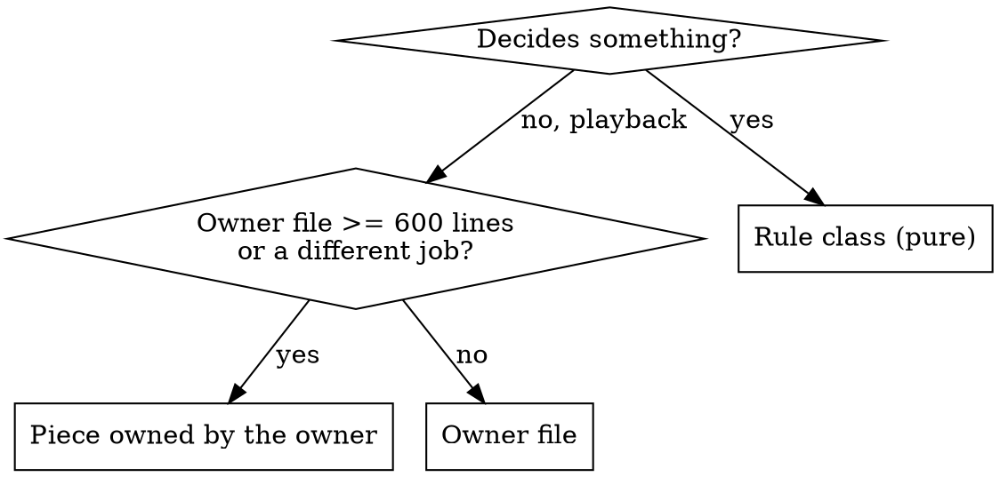

# Structuring Godot Code

## Overview

Every script is one of three kinds, and new code goes to the kind that owns it. A file that is already too big gets **no new responsibility**: the new code gets its own piece, even under time pressure.

**A small piece now costs about 15 minutes. Adding to a 1,800-line class costs the whole refactor later** (`docs/boost/specs/2026-11-14-refactor-arquitectura-design.md`).

## The three kinds

| Kind | Base | Touches nodes? | Holds |
|---|---|---|---|
| **Rule** | `RefCounted` / `Resource` | Never | Game rules, numbers, thresholds, texts. It returns results, such as `{ok, text, ...}` or event arrays |
| **Builder** | `RefCounted`, static only | Creates them for the caller, keeps no state | Meshes, stages, themes. Header starts `## Constructor:` |
| **Node** | `Node` / `Control` / `Node3D`... | Yes | Playback: it calls rules, shows the result, emits signals |

A threshold ("below 25 % HP"), a chance, a cap or a text is a **rule**, even when only one scene uses it. A rule never reads the clock, the command line or a global RNG. It gets them as arguments (`today`, `rng`), so autoplay and the debug panel can drive it.

## Where new code goes

Most features need **both**: split them into the part that decides (a rule) and the part that shows (the owner or a piece).

Check the size with `wc -l` before you decide. Today this always applies to `game.gd`, `world.gd` and `battle_actor.gd`. The owner of a big file gets only the hookup: about 5 lines to create the piece, connect it and keep a façade if needed.

- **Saved or shared state** goes in a field of `GameState`, with its rule class working on it. This includes "global" counters.
- **State that lives only while something plays** stays in the piece.

- **If the refactor pieces exist** (`scripts/game/zone_travel.gd`, `battle_flow.gd`, `scripts/world/map_hud.gd`, `scripts/battle/creature_builder.gd`...), add the code to the matching piece.
- **If they don't exist yet,** create a piece just for the new feature. For example, a fishing feature would get a `FishingFlow`, a `Node` that `Game` owns. The examples in this skill are illustrative, not files in the repo.
- **A figure built in code** goes in a static builder (`creature_builder.gd`, created if missing). `BattleActor` gets only its `LOOKS` entry and the one-line call, until `ActorLooks` exists.

The full piece recipe is in [reference.md](reference.md).

## Quick reference

- **No autoloads.** State that must be "global" is a field of `GameState`, saved per slot. It reaches other code through `setup()`.
- **Signals up, calls down.** A piece never stores its owner. It gets what it needs in `setup()` (state, world, audio, `Callable`s) and emits signals.
- **Command-line flags are read in one place:** `RunFlags` if it exists. Until then, `Game` reads them once in `_ready()` (`_autoplay`, `_autoplay_save`...), and a piece receives the values it needs as `setup()` arguments. Never call `OS.get_cmdline_user_args()` inside feature code. Autoplay code sits together, in its own piece or in a `#region Autoplay`.
- **Data goes in `.tres` plus its library table.** UI colours and sizes come from `UiTokens` / `UiTheme`. A new colour goes to `docs/boost/design-system/` first.
- **`.tscn` files hold only the root node.** Everything else is built in code.
- **A new saved field:**
  - add it as an optional key, so older saves load with its default;
  - make `is_valid()` reject values a played game can't reach (negative counts, unknown ids, more than the cap);
  - bump the version only when the old one can't express the field.
- **`CLAUDE.md` *Layout*, in the same commit.**
- **Verify by hand, never with tests:** `--import`, `--check-only`, the autoplay run that crosses the change, and screenshots for visuals. See `CLAUDE.md` → *Commands*.
- **GDScript style:** see [reference.md](reference.md).

## Red flags: stop and use a piece

| Thought | Reality |
|---|---|
| "It's only 60-90 lines in game.gd" | That is how it reached 1,840. Make a piece. |
| "Ship it in game.gd now, extract later" / "leave a TODO" | Later never comes, and the next feature copies it. A piece is 15 minutes. |
| "A Node piece is architecture work, too risky today" | The recipe is mechanical: `setup()`, a signal, one line in the owner. |
| "The threshold is only used by BattleScene" | It is a rule. Put it in a pure class. |
| "One quick `OS.get_cmdline_user_args().has(...)`" | It goes through the one flags reader. |
| "A singleton is easier" | It leaks between save slots, and the project forbids it. |
| "No time for the piece: fall back to the rule plus a bigger handler" | Tell the human it isn't ready and why. Committing playback into a big owner is never the fallback. |

## Common mistakes

- **The piece stores `Game` or `World`.** That creates a circular dependency. Pass a context or `Callable`s instead.
- **The piece is a child of `World`.** `World` is freed on every zone change, so an `await` inside it dies. Pieces of `Game` live as long as `Game`.
- **A piece has its own `_physics_process`.** Its order then depends on the tree. The owner calls `step()` instead.
- **Rules computed inside `_on_*` handlers.** Move them to the rule class and keep the handler to playback.
